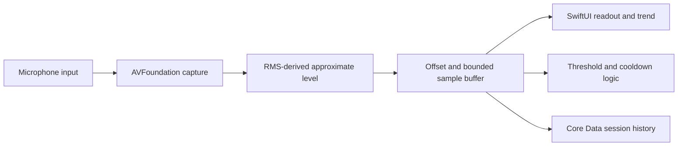

# NoiseGuardian
### iOS environmental-noise awareness app · Swift / SwiftUI / AVFoundation / Core Data

**Built by Jongwan Park during a contract Research Assistant role at City University of Hong Kong (Aug 2025–May 2026).**

NoiseGuardian turns microphone input into a readable live loudness trend, configurable alerts and locally saved sessions. It demonstrates mobile audio integration, bounded state management and persistence in an end-to-end iOS application.

> **Portfolio case study:** this public repository contains documentation only. The implementation is private; there is no public executable demo or App Store release linked here.

## At a glance

| Area | What I built |
|---|---|
| Capture & analysis | Microphone audio capture with AVFoundation and RMS-derived approximate level processing |
| Interface | SwiftUI live readout, rolling trend visualization and session views |
| Persistence | Core Data session history and saved sample data |
| Behaviour | Peak/sustained alerts, cooldown and user-adjustable calibration offset |
| Structure | Separation of acquisition, analysis, persistence and presentation |

## My contribution

- Developed the iOS noise-measurement and visualization application using Swift, AVFoundation and Core Data.
- Separated audio acquisition, signal analysis, persistence and UI into modular components.
- Implemented session visualization and local history so measurements could be inspected after capture stopped.

## How it works

## Engineering decisions worth discussing

- **Bounded buffers:** cap retained live samples so a long monitoring session does not grow UI state indefinitely.
- **Separate capture from presentation:** keep audio-processing responsibilities distinct from main-actor UI updates.
- **Alert state:** combine peak and sustained conditions with a cooldown rather than notifying on every sample.
- **Local persistence:** separate a live session from the saved record a user can inspect later.
- **Honest measurement labels:** distinguish microphone-derived approximate levels from calibrated acoustic measurements.

## User walkthrough

1. Start monitoring and grant microphone permission.
2. Observe the approximate level and rolling trend.
3. Adjust alert thresholds or the manual offset as needed.
4. Stop and save a named session.
5. Open history to inspect the saved series.

These steps describe the application workflow, not a runnable demo in this documentation repository. The private app targets iOS 18.5+ and requires Xcode and a device for meaningful microphone testing.

## Scope and validation

The app is for **approximate environmental loudness awareness**. Microphone RMS plus an offset is not a certified sound-level measurement. Short sample-window arithmetic means must not be described as standardized LAeq, occupational dose or A-weighted SPL.

Controlled software checks are distinct from physical microphone calibration, device testing and acoustic validation. This case study does not claim clinical efficacy, regulatory compliance, certified accuracy or a verified production deployment.

## Interview discussion

I can explain the capture-to-UI data flow, buffer lifecycle, alert timing, Core Data record structure and the trade-offs between approximate trends and calibrated measurements.

[LinkedIn](https://www.linkedin.com/in/jongwan-park-8264432b5/) · [GraphRAG case study](https://github.com/PARK0301/showcase-graphrag) · [GitHub profile](https://github.com/PARK0301)
